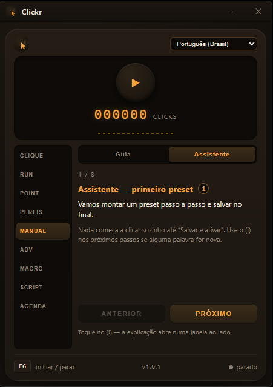

# Clickr


**Autoclicker desktop multiplataforma** — UI amber no estilo “device”, motor de input nativo (SendInput no Windows; pynput no macOS/Linux), atalhos globais, autoclique de mouse e teclado, perfis, macros, scripts e agenda.

**Versão 1.1.0** · Repositório: [vinimeggiotto/clickr](https://github.com/vinimeggiotto/clickr)

## Interface



---

## Aviso legal e uso responsável

- O Clickr envia cliques e teclas ao sistema operacional. Use apenas onde você tem autorização.
- Em jogos online e softwares com **anti-cheat**, autoclickers e macros costumam violar os termos de uso e podem resultar em banimento. O Clickr **não** contorna anti-cheat nem ofusca input.
- Você é responsável pelo uso. O autor não se responsabiliza por sanções, perda de conta ou danos decorrentes do uso inadequado.
- No Windows, janelas elevadas (administrador) podem ignorar o input se o Clickr não estiver elevado.

---

## Recursos

| Área | O que faz |
|------|-----------|
| **Clique** | Mouse (botão L/R/M/4/5) **ou tecla/combinação** (ex.: `E`, `CTRL+C`) · simples / duplo / hold · intervalo em ms · CPS estimado |
| **Run** | Delay de início, jitter, limite de cliques e duração (unidades ms / s / min / h) · modo compacto · always-on-top · iniciar com o sistema · aviso opcional de versão nova |
| **Point** | Cursor ou ponto fixo · captura multi-monitor · jitter de posição · restaurar cursor · sequência editável (capturar para a lista, delay por ponto, reordenar) |
| **Perfis** | Salvar / carregar / renomear / excluir / importar / exportar JSON |
| **Atalhos** | Um atalho global por ação (iniciar/parar, parar tudo, capturar ponto, gravar macro) · combinações como `CTRL+ALT+F6` · modo alternar ou **segurar para clicar** |
| **Manual** | **Guia** (explica) e **Assistente** (configura e salva perfil) |
| **Adv** | Filtro de janela (com “usar janela atual”), burst |
| **Macro** | Gravar e reproduzir (teclas, cliques, rolagem) · repetições e velocidade · salvar / carregar / excluir |
| **Script** | DSL `click` / `dclick` / `move` / `drag` / `scroll` / `wait` / `key` / `type` / `loop`, com referência de comandos na própria aba |
| **Agenda** | Disparo em data/hora local, uma vez, diário ou a cada intervalo · inicia autoclique, perfil, macro ou script · sobrevive ao reinício do app |
| **Ao vivo** | Contagem regressiva do delay, tempo decorrido, cliques/s reais e aviso quando a ação é pulada |
| **Sessão** | A última configuração, o script, os atalhos e a posição da janela voltam ao reabrir |
| **Bandeja** | Fechar a janela oculta o app; item **Iniciar/Parar**; ícone indica execução; **Sair** encerra de verdade |
| **Segurança de uso** | Nunca clica na própria janela do Clickr · uma única instância por usuário |
| **Idiomas** | Português, English, Español, Deutsch, 中文, Русский (inclusive mensagens de erro) |

---

## Requisitos

| SO | Notas |
|----|--------|
| **Windows** 10/11 | Backend SendInput; executável `Clickr.exe` |
| **macOS** | Autorizar **Acessibilidade** (Ajustes → Privacidade). Binário sem notarização pode exigir “Abrir mesmo assim” no Gatekeeper |
| **Linux** | Sessão **X11** (Wayland: limitação conhecida). Runtime: GTK/WebKit (pywebview). Filtro de janela: `xprop` (e opcionalmente `xdotool`) |

- Código-fonte: **Python 3.12** + `requirements.txt`
- Artefatos de CI não exigem Python instalado no destino

---

## Como usar

1. Abra o Clickr (artefato da plataforma ou `python main.py`).
2. Na primeira vez, escolha o idioma (pode mudar depois no seletor do topo).
3. Configure o clique nas abas e use o botão pulse ou o atalho (**F6** por padrão; outros atalhos na aba **Atalhos**).
4. Para encerrar de verdade: ícone na bandeja → **Sair**.

Preferências (`settings.json`), perfis (`profiles/`), macros (`macros/`) e log (`clickr.log`):

| SO | Pasta |
|----|--------|
| Windows | `%APPDATA%\Clickr\` |
| macOS | `~/Library/Application Support/Clickr/` |
| Linux | `$XDG_CONFIG_HOME/Clickr/` ou `~/.config/Clickr/` |

### Compatibilidade com perfis da 1.0.x

Perfis salvos na 1.0.x continuam carregando exatamente como antes, sem conversão:

- Arquivos sem o campo `version` (com ou sem o envelope `config`) são tratados como **v1**: mesma mescla sobre a configuração atual e, se trouxerem `hotkey`, `always_on_top` ou `compact_mode`, esses valores ainda são aplicados.
- Perfis salvos pela 1.1 usam o formato **v2** (`{"name", "version": 2, "config"}`), guardam só a configuração de clique e nunca alteram preferências do aplicativo.
- Arquivos antigos não são reescritos ao carregar.

Detalhes em [`Docs/features/perfis`](Docs/features/perfis/regras-de-negocio.md).

### DSL de script (exemplo)

```text
move 100 200
click left
dclick 300 400
wait 100-250
key CTRL+C
type "olá"
scroll -3
drag 100 200 400 200
loop 3
  click
  wait 50
end
```

Limites: até 500 linhas, loops 1–1000, profundidade de loop ≤ 2. Erros de script indicam o número da linha.

---

## Rodar pelo código-fonte

```bash
python -m pip install -r requirements.txt
python main.py
```

No Windows (PowerShell):

```powershell
python -m pip install -r requirements.txt
python main.py
```

---

## Testes

Suíte Python (pytest, com backend de input nulo — não move o mouse nem exige display):

```bash
python -m pip install -r requirements-dev.txt
CLICKR_INPUT_BACKEND=null python -m pytest -q
```

Teste de UI ponta a ponta (Node.js + Playwright; sobe `tests/ui/devserver.py` com o controller real):

```bash
node tests/ui/smoke.cjs
```

---

## Gerar o executável / app

PyInstaller **não cross-compila**. Use o script do SO alvo (ou o CI).

| SO | Comando | Saída |
|----|---------|--------|
| Windows | `.\build_exe.ps1` | `dist\Clickr.exe` |
| macOS | `./build_macos.sh` | `dist/Clickr.app` |
| Linux | `./build_linux.sh` | `dist/Clickr` |

Specs: `packaging/Clickr.windows.spec`, `packaging/Clickr.macos.spec`, `packaging/Clickr.linux.spec`.

Os scripts regeneram o ícone (`scripts/generate_icon.py`) antes do PyInstaller.

### CI e releases

Workflow [`.github/workflows/build.yml`](.github/workflows/build.yml): job `test` (pytest) + matrix de build Windows / macOS / Linux.

- Push/PR: roda os testes e sobe artifacts por plataforma
- Tag `v*`: publica na GitHub Release `Clickr.exe`, `Clickr.app.zip`, `Clickr` e `SHA256SUMS` (para conferir a integridade dos downloads)

---

## Limitações conhecidas

- **macOS Gatekeeper / notarização:** não incluídos nesta entrega; pode ser necessário liberar o app manualmente.
- **Linux Wayland:** input sintético e filtro de janela focados em X11.
- **Botões X1/X2:** suporte completo no Windows; em macOS/Linux depende do pynput.
- Sem `xprop` no Linux, filtro de janela **com critérios** falha com erro explícito (não libera clique).
- **Atalhos em macOS/Linux:** a tecla do atalho também chega ao programa em foco (no Windows ela é consumida pelo sistema).
- **Autoclique de teclado em macOS/Linux:** não há bloqueio de envio de teclas quando a janela em foco é o próprio Clickr (no Windows há).

---

## Estrutura

```text
app/           Controller, tray, bootstrap, settings, instância única, autostart, updates, log
core/          Motor + fachada sendinput (win32 / pynput / nulo), tabela de teclas, erros
hotkeys/       Atalhos globais (combinações, backends win32 / pynput)
profiles/      Persistência de perfis
macros/        Gravação, reprodução e macros salvas
scripts/       DSL runner
scheduler/     Agenda
sequence/      Sequência multi-ponto
window_filter/ Filtro de janela por SO
ui/            Interface (HTML/CSS/JS) e idiomas
tests/         Testes pytest + teste de UI (tests/ui)
assets/        Ícones e logos
packaging/     Specs PyInstaller por SO
VERSION        Semver do app (splash + rodapé)
Docs/          Documentação do projeto
```

---

## Comunidade

- [Como contribuir](CONTRIBUTING.md)
- [Código de conduta](CODE_OF_CONDUCT.md)
- [Política de segurança](SECURITY.md)

## Licença

Este software é distribuído sob a **[PolyForm Noncommercial License 1.0.0](LICENSE)** (copyright 2026 Vinicius Meggiotto).

- Uso **não comercial** permitido nos termos da licença; **não** é uma licença OSI “Open Source”.
- Fornecido **“como está”**, sem garantia. Uso por sua conta e risco.

Texto integral: [`LICENSE`](LICENSE).
